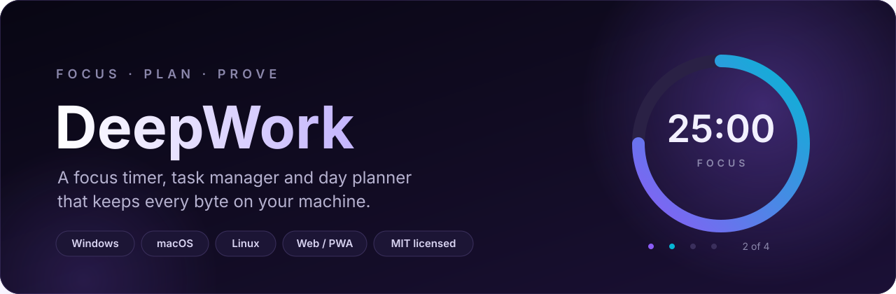
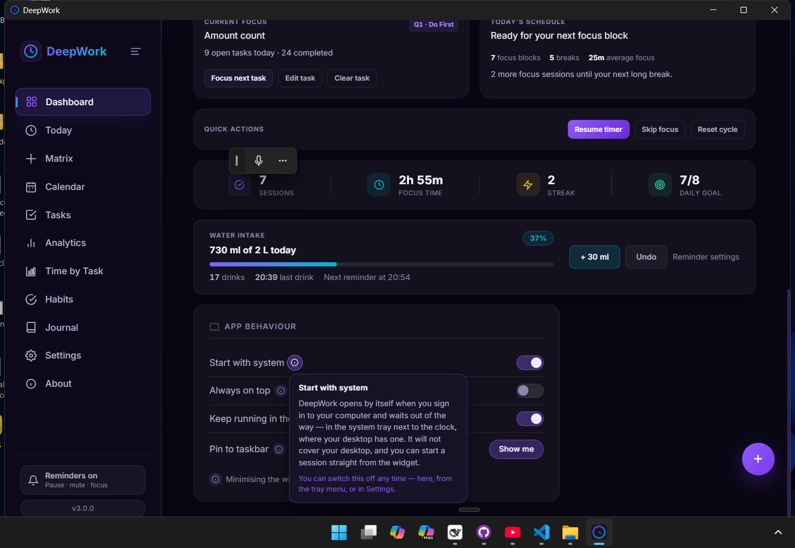
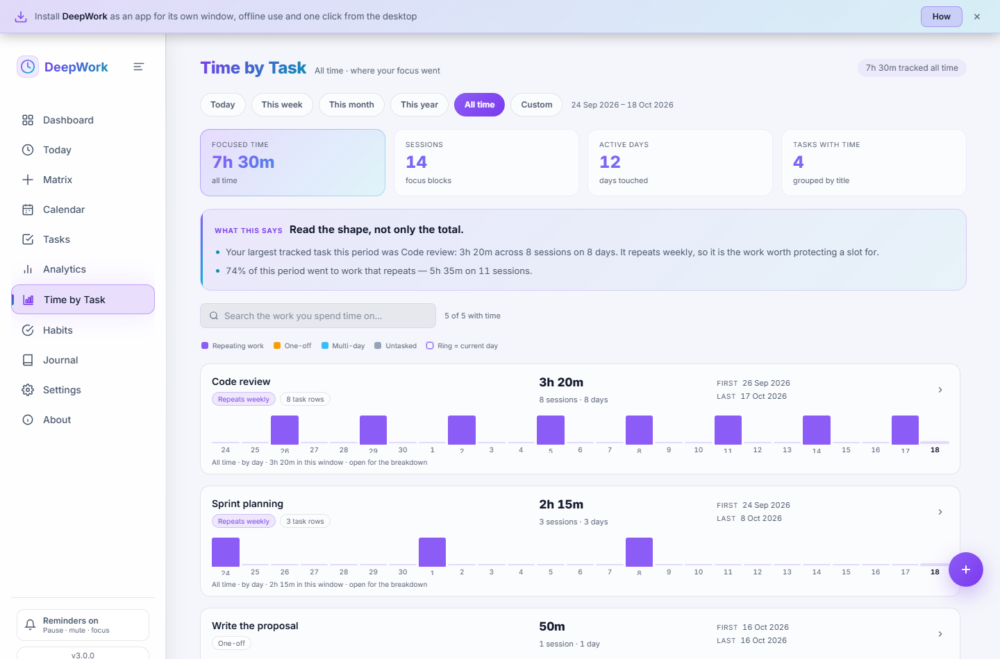
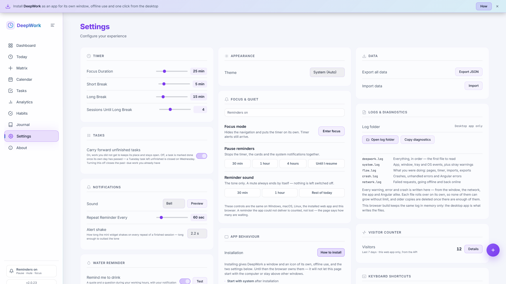

<div align="center">

# DeepWork

### Free, Open-Source, **100% Local** Focus Timer, Task Manager & Day Planner

**Open it. Pick a task. Start the clock. Your work stays on your machine.**
No account. No cloud. No subscription. Nothing about your work leaves the machine.

[](https://github.com/malikrajat/deepwork/actions/workflows/ci.yml)
[](https://github.com/malikrajat/deepwork/actions/workflows/deploy.yml)
[](https://github.com/malikrajat/deepwork/releases/latest)
[](https://github.com/malikrajat/deepwork/releases)
[](LICENSE)
[](#-quick-start)
[](https://tauri.app/)
[](https://angular.dev/)

[**Quick Start**](#-quick-start) · [**Features**](#-features) · [**vs. Pomofocus / Forest / Todoist**](#-why-deepwork) · [**The App**](#-the-app-page-by-page) · [**Privacy**](#-privacy-pledge) · [**Contributing**](#-contributing)

</div>



<div align="center">

### [⬇&nbsp; Download for Windows](https://github.com/malikrajat/deepwork/releases/download/v3.1.0/DeepWork%5F3.1.0_x64-setup.exe)

[**macOS (Apple Silicon)**](https://github.com/malikrajat/deepwork/releases/download/v3.1.0/DeepWork%5F3.1.0_aarch64.dmg) &nbsp;·&nbsp; [**Linux (.deb)**](https://github.com/malikrajat/deepwork/releases/download/v3.1.0/DeepWork%5F3.1.0_amd64.deb) &nbsp;·&nbsp; [**Linux (.rpm)**](https://github.com/malikrajat/deepwork/releases/download/v3.1.0/DeepWork-3.1.0-1.x86_64.rpm) &nbsp;·&nbsp; [**Open the web app**](https://app.deepwork.rajatmalik.dev/)

<sub>Windows 10+ · macOS · Linux x64 · or any modern browser · free · MIT · no sign-up · latest published release: <a href="https://github.com/malikrajat/deepwork/releases/latest">see all installers</a></sub>

</div>

<p align="center">
  
  
  
</p>

DeepWork is a **free, open-source alternative to Pomofocus, Forest, Todoist and a notebook of good intentions** — for people who want a Pomodoro timer, an Eisenhower matrix, a day planner, a habit tracker and a journal **in one window, with no account and no cloud**. Built with [Tauri 2](https://tauri.app/) and [Angular 22](https://angular.dev/), it runs as a native desktop app on **Windows, macOS and Linux**, and as an installable web app (PWA) in the browser.

**Looking for:** *Pomodoro timer without an account*, *offline focus timer*, *local task manager*, *open-source Forest alternative*, *Pomofocus alternative with tasks*, *Eisenhower matrix desktop app*, *habit tracker that stays on your machine*, *Tauri productivity app*. You found it.

---

## 🌟 Why this exists

Most productivity apps ask for an account before they show you a clock. Your tasks, habits and journal end up on someone else's server, behind a subscription, inside a product that can change its mind about both.

DeepWork exists because **a focus timer does not need the internet.**

- 🔒 Your database is a file on your computer — there is no backend to send it to
- 🆓 Free forever — no account, no API key, no subscription
- 🔌 Works offline, on a plane, behind a proxy, after the internet is gone
- 🛠️ Fork it, change it, ship your own version — MIT licensed
- 🧮 Same records, same reading, every time — the analysis is arithmetic and rules, **not AI**

This is a **personal project released for anyone who wants it**, not a product with a support SLA. If it helps you do deeper work, that is the point. If something is broken, an issue or a pull request is welcome.

> **A note from the maintainer:** I built DeepWork for myself because I wanted a timer, a task list and a record of where the week actually went — without signing up for another service to get them. It grew from there. Use it, fork it, change the colours, ship it to your team. The only thing I ask is that you keep the [LICENSE](LICENSE) notice intact. If you build something with it, I would like to hear about it — but you do not owe me anything.
>
> — **Rajat Malik**

---

## ⚡ Why DeepWork?

| Feature | **DeepWork** | Pomofocus | Forest | Todoist | Notion | Microsoft To Do |
|---|:---:|:---:|:---:|:---:|:---:|:---:|
| **Works fully offline** | ✅ | ⚠️ browser cache | ✅ mobile | ❌ | ❌ | ⚠️ |
| **Local database — no account** | ✅ | ⚠️ browser storage | ✅ | ❌ | ❌ | ❌ |
| **Free, with no usage cap** | ✅ | ✅ | ❌ one-time paid | ❌ premium tiers | ❌ premium tiers | ✅ |
| **Open source** | ✅ | ❌ | ❌ | ❌ | ❌ | ❌ |
| **Pomodoro timer built in** | ✅ | ✅ | ✅ | ⚠️ integration | ❌ | ❌ |
| **Tasks + Eisenhower matrix** | ✅ | ❌ | ❌ | ⚠️ priorities | ⚠️ manual | ⚠️ |
| **Day planned in focus blocks** | ✅ | ❌ | ❌ | ❌ | ❌ | ❌ |
| **Habits and streaks** | ✅ | ❌ | ❌ | ❌ | ⚠️ manual | ❌ |
| **Journal and writing correlation** | ✅ | ❌ | ❌ | ❌ | ✅ pages | ❌ |
| **Time by task, with rhythm** | ✅ | ❌ | ⚠️ | ⚠️ | ❌ | ❌ |
| **Plain-language analytics** | ✅ | ⚠️ charts only | ⚠️ charts only | ⚠️ charts only | ❌ | ⚠️ |
| **Desktop app: tray, mini widget, always-on-top** | ✅ | ❌ | ❌ | ✅ | ✅ | ✅ |
| **Reminders that persist across restarts** | ✅ | ❌ | ⚠️ | ✅ | ⚠️ | ✅ |
| **Excel/CSV import and export** | ✅ | ❌ | ❌ | ✅ | ✅ | ⚠️ |
| **No account required** | ✅ | ✅ | ✅ | ❌ | ❌ | ❌ |
| **Hackable / MIT licensed** | ✅ | ❌ | ❌ | ❌ | ❌ | ❌ |

---

## ✨ Features

### 🎯 Focus & time

- ⏱️ **A Pomodoro cycle that behaves like one** — focus, short break and long break with configurable lengths, an animated ring and a session count until the next long break
- 🛎️ **A completion alert that asks to be answered** — it rings until you respond, with a tagged system notification, a shake whose length you choose in Settings, and a walk through a twelve-colour palette. Every alert carries one of 24 step-away lines for focus and 24 come-back lines for a break
- 🔕 **Pause, mute and focus everywhere** — the same panel opens from the sidebar, the phone's top bar, Settings and `Ctrl+Shift+Q`. A pause holds the timer and every reminder; a mute is sound-only and ends by itself
- 🪟 **A mini widget for the corner of your screen** — frameless, draggable, always on top, with play/skip/stop and an expand arrow. Minimising the app opens it; `Esc` restores the full window
- 🖥️ **Desktop manners** — system tray, start with the system, always on top, and an X that hides rather than quits, so a session can finish and ring while the window is away
- ⌨️ **A command palette on `Ctrl+K`** — searches session actions, pages and the task form, with arrow keys, Enter to run and Escape to close
- 🗂️ **A keyboard shortcut panel on `?`** — the current bindings, including Space to start/pause, `S` to skip, `R` to reset, `F` for fullscreen and `M` for the widget

### ✅ Tasks & planning

- 🧭 **An Eisenhower matrix** — four quadrants, drag-and-drop between them, a resizable task list and collapsible panels
- 📋 **A Jira-style status board** — To Do / In Progress / Done, filed into Today, Tomorrow, next week, later months, and the past sections behind them
- 📌 **A Today view that means today** — a task dated today, an overdue task still open, or one written today with no deadline. Starring a task pulls it onto today whatever its date says
- 🗓️ **A calendar of focus blocks** — your quadrants planned as pomodoros, at the block length and long-break cadence the timer already uses
- 📥 **Excel/CSV import with a real preview** — `.xlsx`, `.xlsm` and `.csv`, common header aliases (`Task`, `Due Date`, `Prio`, `Labels`, …), row validation and nothing written until you confirm. Duplicate titles are labelled and can be skipped
- 📤 **CSV export that tells you where the file went** — 24 columns, quick date ranges, an optional totals block, UTF-8 with a BOM so accents and CJK text survive Excel, written to Downloads with the full path reported
- ✏️ **Edit a task from wherever you read it** — one slide-in form over the page you were on. Add and edit from a board card, a matrix card, a calendar block, the dashboard or a date-section header without losing the route, scroll position or filter
- ⏲️ **Time by Task** — every focus session grouped by the work it paid for, not by row: all-time time, sessions and days, first and last session, a daily/weekly/monthly/one-off rhythm, a Today filter, a custom range, and week/month/year bars. Virtualised, so a thousand tasks cost the same as ten
- 🧹 **An unfinished-work policy you choose** — carry yesterday's open tasks forward (the default) or let them close when their day passes
- 🔔 **Reminders that keep asking** — store a title, note, moment and rhythm once. A reminder survives a restart, escalates instead of repeating on a stopwatch, carries *Done / Snooze / Stop* on its desktop notification, and never brings the window forward

### 🌱 Wellbeing & reflection

- 🔥 **Habits with a memory** — daily check-ins, the current streak and your personal best
- 📔 **A journal with a point** — dated entries, word counts, a weekly words chart, and the writing-versus-focus correlation surfaced on Analytics
- 📊 **Analytics with a reading, not just a chart** — focus, task, habit and journal figures with trends and streaks, each paired with the plain-language "what should I change?" half
- 💧 **A water reminder that asks** — off by default, offered rather than imposed, counted only while the app is running, and a single comfortable mouthful per drink (**50 ml** unless you choose another size)
- 🚶 **A stand-and-walk reminder** — the same manners: off by default, offered in the same two places, one click on the Dashboard to turn on or off

### 🌍 Everywhere you work

- 🖥️ **Native desktop apps** for Windows 10+, macOS and Linux x64
- 🌐 **The whole app in a browser** — [app.deepwork.rajatmalik.dev](https://app.deepwork.rajatmalik.dev/) can be installed as a PWA, with an install prompt, start-with-system support and a floating always-on-top timer where the browser allows it
- 🎙️ **Voice typing in the browser build** — the task title, description, quick-add and journal each carry a microphone. It is deliberately web-only; the packaged desktop app never shows it
- 🌗 **Light, dark or system theme** — follows the OS unless you choose otherwise
- 💾 **Backup and restore** — one JSON file for sessions, tasks, habits, journal and water records
- 🩺 **Logs and diagnostics** — five log files, an open-log-folder button and a copy-diagnostics action that includes the last 300 lines and your environment

### 🔒 Data

- 🗄️ **SQLite on your disk** (`deepwork.db`) — no backend, no account, no sync
- 🧠 **No AI and no model** — the analysis is deterministic arithmetic and rules the app carries inside itself
- 📡 **No telemetry in the desktop app** — the web build counts visits with GoatCounter, and you can switch that off
- 🔤 **Fonts that travel with the app** — Inter and JetBrains Mono ship inside the bundle, so it looks like itself offline

---

## 🚀 Quick Start

### Option 1 — install an app (Windows, macOS, Linux)

<!-- Installer URLs pin the published v3.1.0 assets. The `_` in `DeepWork_` is
     percent-encoded so `npm run version:check` reads these as links to a
     published release, not as a claim about the current source version. -->
| Platform | File | Direct download |
|---|---|---|
| **Windows 10+ (64-bit)** | DeepWork 3.1.0 x64 setup (`.exe`) | [⬇ Download](https://github.com/malikrajat/deepwork/releases/download/v3.1.0/DeepWork%5F3.1.0_x64-setup.exe) |
| **macOS (Apple Silicon)** | DeepWork 3.1.0 arm64 (`.dmg`) | [⬇ Download](https://github.com/malikrajat/deepwork/releases/download/v3.1.0/DeepWork%5F3.1.0_aarch64.dmg) |
| **macOS (Intel)** | DeepWork x64 (`.dmg`) | [Choose the x64 image on the releases page](https://github.com/malikrajat/deepwork/releases) |
| **Linux (Debian/Ubuntu)** | DeepWork 3.1.0 amd64 (`.deb`) | [⬇ Download](https://github.com/malikrajat/deepwork/releases/download/v3.1.0/DeepWork%5F3.1.0_amd64.deb) |
| **Linux (Fedora/RHEL)** | DeepWork 3.1.0 x86_64 (`.rpm`) | [⬇ Download](https://github.com/malikrajat/deepwork/releases/download/v3.1.0/DeepWork-3.1.0-1.x86_64.rpm) |
| **Linux (portable)** | `.AppImage` when the release carries one | [See all releases](https://github.com/malikrajat/deepwork/releases) |

The links above are pinned to the **v3.1.0** installers, the newest published release as this README was written. If a newer release exists, the [releases page](https://github.com/malikrajat/deepwork/releases) is the source of truth; the app's **About → Get it on another device** also resolves each row against the newest release it has already fetched.

### Because the installers are unsigned

This is the honest version of what happens on a fresh download:

- **Windows** — SmartScreen may interrupt with "Windows protected your PC", and UAC says _Unknown publisher_. Choose **More info → Run anyway** only if you trust the source. The publisher, copyright and category are set correctly in [`tauri.conf.json`](src-tauri/tauri.conf.json), so Add/Remove Programs names the developer even though the Authenticode signature is absent.
- **macOS** — Gatekeeper refuses the first launch with _"DeepWork" Not Opened — Apple could not verify "DeepWork" is free of malware_. That is the unsigned, un-notarized app, not a broken download. The Control-click → _Open_ trick no longer works on macOS 15 (Sequoia) or later, so open **System Settings → Privacy & Security → Security → Open Anyway** after trying once, or clear the flag from Terminal: `xattr -dr com.apple.quarantine /Applications/DeepWork.app`.
- **Linux** — `chmod +x DeepWork_*.AppImage` before running a portable build.

The full picture — what a certificate or notarization ticket would change, how to configure a certificate store or cloud signer, and how to verify a build before publishing — is in [`docs/code-signing.md`](docs/code-signing.md).

### Option 2 — open the web app

[app.deepwork.rajatmalik.dev](https://app.deepwork.rajatmalik.dev/) runs the whole app in a modern browser. Add it to your desktop from the address bar to install the PWA. In a browser tab it offers installation in the window and, once a week, as a system notification.

> The browser build stores its data in `localStorage` for that origin. Clearing site data erases it, and the desktop build is the one with the real SQLite database. Export a JSON backup before clearing anything.

### Option 3 — from source

```bash
git clone https://github.com/malikrajat/deepwork.git
cd deepwork
npm install

npm run start       # Angular dev server on http://localhost:4999 (browser build)
npm run tauri:dev   # the real desktop window, hot reload, 15–25 min on a first Rust build
```

Prerequisites and per-platform setup are in [Install, build and develop](#-install-build-and-develop). The dev server runs on **4999**, not 4200 — that is the port [`tauri.conf.json`](src-tauri/tauri.conf.json) points its `devUrl` at, and `npm run e2e` starts its own server on 4202 so the two never collide.

### Verify a download

If a release publishes a SHA-256 checksum, compare it before installing:

```powershell
Get-ChildItem .\DeepWork*.exe | Get-FileHash -Algorithm SHA256
```

```bash
sha256sum DeepWork_*.deb
```

### First launch

A one-time dialog offers **start with system**, **always on top** and **keep running in the tray**. No installer writes a startup entry, and nothing is enabled unless you ask for it.

| | |
|---|---|
| **Desktop** | Open DeepWork from the Start menu / Applications / your launcher |
| **Web** | Open [app.deepwork.rajatmalik.dev](https://app.deepwork.rajatmalik.dev/) and install it from the browser |
| **First useful thing** | Press `Ctrl+K`, pick *Add task*, then start a 25-minute session on it |

---

## 🗂️ The app, page by page

| Page | What is there |
|---|---|
| **Dashboard** | The focus timer and its ring, sessions against your daily goal, the next long break, the day's schedule headline, today's tasks, the water card and the desktop-behaviour card |
| **Today** | The day's own work on the same status board as Tasks: a task dated today, an overdue task still open, or one written today with no deadline |
| **Matrix** | The Eisenhower view: four quadrants, a resizable task list, drag-and-drop and collapsible panels |
| **Calendar** | Your quadrants scheduled into focus blocks — the day planned as pomodoros at the block length and long-break cadence your timer settings define |
| **Tasks** | The status board filed into date sections, with add, edit, delete, search, sort, Excel/CSV import and CSV export |
| **Analytics** | Focus, task, habit and journal figures with trends, streaks and a plain-language reading of each one |
| **Time by Task** | Every focus session grouped by the work it paid for: all-time totals, first and last session, repeat rhythm, Today, a custom range, and week/month/year bars |
| **Reminders** | Things that must not be missed: a title, a note, a moment and a rhythm, stored rather than scheduled, asked about until answered |
| **Habits** | Daily habits with the current streak, the personal best and a check-in strip per habit |
| **Journal** | Dated entries with word counts, a weekly words chart and the writing-versus-focus correlation |
| **Settings** | Timer lengths, notification sound and repeat interval, alert shake, water reminder, desktop behaviour, logs and diagnostics, JSON backup and restore, and the web visitor counter |
| **About** | Who builds this, how to get in touch, the update check, and the download rows for other devices |

Two things worth calling out because they are unusual:

- **Excel/CSV import with a real preview.** `Tasks → Import` accepts `.xlsx`, `.xlsm` and `.csv`, recognises common header aliases, validates every row, and writes nothing until you confirm. _Download template_ produces a dated workbook with dropdowns, header hints and an instructions sheet.
- **CSV export that tells you where the file went.** 24 columns per task, quick date ranges, an optional totals block, UTF-8 with a BOM, and the full path reported in the panel and in a toast. An existing name is never overwritten: the second export of the day becomes `export-2026-09-13 (2).csv`.

---

## 🔒 Privacy pledge

DeepWork makes the following network calls and **no others**:

1. **The update check** — one unauthenticated `GET` to the GitHub releases API for this repository, on startup and when you press _Check for updates_, cached for six hours so it does not burn the 60-requests-per-hour allowance. It sends nothing about you and reports nothing back.
2. **An installer download**, only when you press **Update**. The request is made by Rust with `curl` ([`updates.rs`](src-tauri/src/updates.rs)); only `https` links to `github.com` are accepted, and only a file the app itself wrote to its own temp folder can be started.
3. **Links you click**, opened in your real browser ([`opener.rs`](src-tauri/src/opener.rs)) — `http`, `https` and `mailto` only, with control characters refused.
4. **The web build's visitor counter**, and only in the browser. The desktop app is never counted.

The visitor counter uses [GoatCounter](https://www.goatcounter.com/) on [app-deepwork.goatcounter.com](https://app-deepwork.goatcounter.com/) so "is anybody actually using this?" has an answer without DeepWork having a server of its own. It is bounded:

- **You can switch it off.** **Count my visits**, under `Settings → Visitor Counter → Details`, is on by default. With it off the script is never fetched at all, so nothing leaves the machine.
- **It sends the page, not your work.** The path (`/tasks`), the page title, the referrer, and the browser's own screen width, language and time zone — never a task, a journal entry, a habit or any identifier. GoatCounter stores no IP address and sets no cookie of its own for this ([its GDPR note](https://www.goatcounter.com/gdpr) explains why that needs no consent banner).

Beyond that there is no telemetry, no analytics service, no crash-reporting service and no font CDN.

**Where things are kept:**

| Build | Storage |
|---|---|
| Desktop (Tauri) | SQLite file `deepwork.db` in the app's data directory (`com.deepwork.app`): `%APPDATA%` on Windows, `~/Library/Application Support` on macOS, `~/.local/share` on Linux |
| Browser | `localStorage` for that origin — clearing site data erases it |
| Logs (desktop) | `%LOCALAPPDATA%\com.deepwork.app\logs` · `~/Library/Logs/com.deepwork.app` · `~/.local/share/com.deepwork.app/logs`; Settings opens the folder for you |

**Backup and restore:** `Settings → backup` writes a single `deepwork-export-YYYY-MM-DD.json` containing your sessions, tasks, habits, journal and water records. Importing one **overwrites your current data** after a confirmation prompt — it is a restore, not a merge, so export first if you are unsure.

---

## 🧠 Behaviour worth knowing

**The window.** The X hides DeepWork to the tray rather than quitting, and everything keeps running while it is hidden — a session can finish and ring. Tray → **Exit** (or turning off _keep running in the tray_) is what quits. Minimising shrinks the app into the mini widget. Every other window keeps its own close, minimise and zoom controls, and leaving the widget re-asserts them rather than assuming they came back.

**The completion alert.** A finished session rings until answered, from the app, the widget or the desktop notification. Every repeat arrives three ways: a tagged system notification, a shake whose length you choose, and the next colour of a twelve-entry palette. **Next** moves on and starts the next session, so answering it carries on rather than leaving a full clock waiting for a second press. A notification you cross comes back three minutes later — crossing is not answering.

**Ticking a task off** raises a card with a third list of 24 lines. It deliberately makes no sound and does not repeat: a task gets ticked off dozens of times a day.

**Time by Task groups the work, not the row.** A daily routine is a new task every day, so counting rows would answer the wrong question. *Code review* on Monday and *Code review* on Tuesday become one line with one all-time total, one first session, one last and one rhythm. A renamed task moves its history under the new name; a deleted task keeps the title recorded on its sessions (`013_add_session_task_title.sql`), so its hours do not turn into untasked time.

**The list is a window, not a page.** Only the rows inside the scroll viewport exist in the DOM, so scrolling is cheap however long the history gets. A row is a fixed-height summary; opening it raises a detail sheet with the breakdown table, stats and recent sessions.

**Standing reminders do not give up.** A reminder is a stored record rather than a timer, so closing the laptop does not cancel it: the first pass after a launch compares its moment with the wall clock and says *"It was due at 09:00. We kept it for you."* It repeats on a ladder — three, five, ten, fifteen, twenty, then every thirty minutes for **Insistent**; longer for **Steady** and **Gentle** — measured from the last real ring. The only exits are **Done**, **Snooze 10 min** and **Stop reminding**.

**Voice typing is a browser-only feature.** In a tab or the installed PWA, the task form, quick-add and journal carry a microphone. A refused permission does not disappear into silence: the app explains that the browser will not ask twice, names the site-settings route back, and leaves the button in place. Browsers without the Web Speech API hide the microphone instead of offering one that cannot work.

---

## ⌨️ Keyboard shortcuts

| Keys | What they do |
|---|---|
| `Ctrl+K` | Open the command palette (pages, session actions, task form) |
| `?` | Open the keyboard shortcut panel |
| `Ctrl+N` | Add a task for today from any page (the browser takes this key for a new window; the desktop app does not) |
| `Ctrl+1` … `Ctrl+0` | Jump to Dashboard, Today, Matrix, Calendar, Tasks, Analytics, Time by Task, Habits, Journal, Settings. About has no number — open it from the version badge |
| `Ctrl+Shift+F` | Toggle focus mode |
| `Ctrl+Shift+Q` | Open the pause / mute / focus panel |
| `Space` | Start or pause the timer (Dashboard, when you are not typing in a field) |
| `S` / `R` | Skip the session / reset the cycle |
| `F` | Fullscreen the timer |
| `N` / `E` / `M` | Focus the next task / edit the linked task / open the mini widget |
| `Esc` | Leave the mini widget, leave focus mode, or close a dialog |
| `1` `2` `3` | With a task card focused: move it to To Do, In Progress or Done |
| `←` `→` | With a task card focused: walk it along the board |
| `Enter` | With a task card focused on the Tasks page: open it for editing |
| `←` `→` `Home` `End` | With the matrix divider focused: resize the task list (`Shift` for larger steps) |

---

## 🏗️ How it works

```text
┌──────────────────────────────┐
│  Angular 22                  │  standalone components, signals,
│  pages · services · utils    │  Tailwind, Lucide icons
└──────────────┬───────────────┘
               │  invoke() / tauri-plugin-sql
               ▼
┌──────────────────────────────┐
│  Tauri 2 (Rust)              │  tray · windows · notifications
│  shell + commands            │  autostart · downloads · opener
└──────────────┬───────────────┘  logging · update fetch
               │
               ▼
┌──────────────────────────────┐
│  SQLite                      │  deepwork.db in the per-user
│  numbered, additive migrations│  application-data directory
└──────────────────────────────┘

Browser build: the same Angular app, with localStorage
instead of SQLite and no Rust shell around it.
```

The analysis layer is pure TypeScript in [`insights.util.ts`](src/app/core/utils/insights.util.ts) — functions that take the records and `now`, return a figure and a sentence, and can be tested without a browser.

---

## 📦 Tech stack

**Frontend:** Angular 22 · TypeScript · Tailwind CSS 4 · RxJS · Lucide · `@codewithrajat/rm-ng-editor`
**Desktop:** Tauri 2 · Rust · `tauri-plugin-sql` (SQLite) · `tauri-plugin-notification`
**Testing:** Vitest · Playwright · ESLint · Prettier
**Bundled typefaces:** Inter · JetBrains Mono (SIL Open Font License 1.1)

---

## 🛠️ Install, build and develop

### Prerequisites

| Tool | Needed | Check |
|---|---|---|
| **Node.js** | `^22.22.3`, `^24.15.0` or `>=26` (see `engines` in `package.json`; `.nvmrc` pins 24.15.0) | `node --version` |
| **npm** | 11.x (`packageManager` in `package.json`) | `npm --version` |
| **Rust** | 1.77.2 or newer (Tauri builds only) | `rustc --version` |
| **Git** | any recent version | `git --version` |

Windows also needs **VS Build Tools** with the C++ workload; Linux needs the webkit2gtk/AppIndicator development packages. [SETUP.md](SETUP.md) has the exact commands per platform.

### Run it

```bash
git clone https://github.com/malikrajat/deepwork.git
cd deepwork
npm install

npm run start       # browser build on http://localhost:4999
npm run tauri:dev   # desktop window with hot reload
```

### Build an installer

Tauri does **not** cross-compile: build each platform on that platform, or let CI do it.

| Platform | Command | Where the artefacts land |
|---|---|---|
| Windows (64-bit) | `npm run build:windows` | `src-tauri/target/x86_64-pc-windows-msvc/release/bundle/msi/` and `bundle/nsis/` |
| Windows (32-bit) | `npm run build:windows32` | `src-tauri/target/i686-pc-windows-msvc/release/bundle/` |
| macOS (Intel) | `npm run build:mac` | `src-tauri/target/x86_64-apple-darwin/release/bundle/` |
| macOS (ARM) | `npm run build:mac-arm` | `src-tauri/target/aarch64-apple-darwin/release/bundle/` |
| Linux (64-bit) | `npm run build:linux` | `src-tauri/target/x86_64-unknown-linux-gnu/release/bundle/` — `.deb`, `.rpm` and `.AppImage` |

There is no 32-bit macOS build (Apple removed 32-bit support in macOS 10.15), and no 32-bit Linux build: DeepWork's tray requires `libappindicator`, which Ubuntu does not publish for i386. CI publishes five installers: Windows x64 and x86, Linux x64, macOS arm64 and x64.

The exact file names carry the current version — on a 3.3.0 checkout they read `DeepWork_3.3.0_x64-setup.exe`, `DeepWork_3.3.0_amd64.deb` and `DeepWork_3.3.0_aarch64.dmg` — and artefacts sit under `target/<triple>/release/bundle/`, not directly under `target/release/`.

Two things are true of every build: **the fonts ship inside it**, and **the packaged app has no web inspector** — the `devtools` cargo feature is deliberately absent from [`src-tauri/Cargo.toml`](src-tauri/Cargo.toml). Debug builds get one either way.

**Upgrading keeps the user's work.** An installer replaces the application files; the SQLite database lives outside the bundle, under the same identifier (`com.deepwork.app`) and the same path. Migrations are additive and numbered, so a newer build applies only what an older database is missing. [`tests/unit/migrations-upgrade.spec.ts`](tests/unit/migrations-upgrade.spec.ts) applies the real SQL to an older schema and checks that tasks, sessions, habits, journal entries and settings survive.

---

## 🧪 Tests, coverage and CI

```bash
npm run lint             # ESLint
npm run css:audit        # fails on dead or test-only CSS
npm run format:check     # Prettier, check only (npm run format writes)
npm test                 # Vitest unit suite
npm run test:coverage    # + coverage; fails if the gate is not met
npm run coverage:summary # today's percentages and the distance to the 90% goal
npm run e2e              # Playwright, starts its own dev server on 4202
npm run build            # Angular production build
npm run verify           # lint + CSS audit + tests + build in one go
```

**The coverage gate** is two rules, both in [`vitest.config.ts`](vitest.config.ts), and either one fails the run:

1. **Nothing goes backwards.** A floor per metric that the suite has already reached.
2. **The logic layer stays at 90%.** `src/app/core/utils/**` — the analytics engine, the CSV/xlsx/zip helpers, the date and windowing maths — must hold 90% statements, 90% lines and 90% functions.

Coverage is measured over **every** file in `src/app`, whether or not a test imports it. What is left below 90% is the pages and the browser shell, which the Playwright suite is meant to cover instead.

**CI** (`.github/workflows/`) runs for `main` only, plus any `v*` tag:

| Job | Runs |
|---|---|
| **Lint** | `npm run lint`, `npm run css:audit` and `npm run version:check` |
| **Format** | `prettier --check` over the files the change touches |
| **Unit tests** | `npm run test:coverage` and `npm run coverage:summary` |
| **Build** | `npm run build` |
| **E2E** | `npm run e2e` against a dev server it starts itself |
| **Installers** | `npm run tauri:build` per OS, independently, on every push to `main` and every `v*` tag |
| **Desktop format** | `cargo fmt --check` |
| **Release** | on a `v*` tag, publishes the installers the other jobs uploaded |

The jobs run independently: a red browser suite says the browser suite is red, and does not cancel the unit tests, the compile or the installers.

`deploy.yml` builds the web app with `npm run build:github` and publishes `dist/deepwork/browser` to GitHub Pages on every push to `main`. It writes the shell out a second time as `404.html`, because Pages has no rewrite rules and a refresh on `/tasks` would otherwise get GitHub's own 404. [`docs/deployment.md`](docs/deployment.md) has the settings this depends on.

---

## 📁 Project structure, and where to change what

```text
src/                 Angular frontend
  app/core/          services, constants, pure utilities (the measured logic layer)
  app/pages/         Dashboard, Today, Matrix, Calendar, Tasks, Analytics,
                     Time by Task, Reminders, Habits, Journal, Settings, About
  app/shared/        components, directives, pipes used by more than one page
src-tauri/           Rust side: tray, autostart, window/db/logging, downloads,
                     update fetch, opener
public/              PWA manifest, service worker, favicons, font licences
tests/unit/          Vitest specs      tests/e2e/   Playwright specs
specs/               Feature specifications (Spec Kit), 001 → 017
docs/                Developer documentation — start at docs/INDEX.md
scripts/             version bump + coverage summary
```

A short map for the changes people actually want to make:

| To change… | Edit |
|---|---|
| What the app says about itself (tagline, version) | [`app-info.constants.ts`](src/app/core/constants/app-info.constants.ts) |
| The About page's wording and contact links | [`about.constants.ts`](src/app/core/constants/about.constants.ts) |
| Which platforms the download rows offer | [`downloads.constants.ts`](src/app/core/constants/downloads.constants.ts) |
| What the analysis computes | [`insights.util.ts`](src/app/core/utils/insights.util.ts) |
| The five log files and what goes in them | `log.service.ts` and `src-tauri/src/logging.rs` |
| Installer metadata, window size, bundle targets | [`src-tauri/tauri.conf.json`](src-tauri/tauri.conf.json) |
| The version number, everywhere it is written down | `npm run version:bump -- x.y.z` |
| Where the visitor counter sends its data | [`visitor.constants.ts`](src/app/core/constants/visitor.constants.ts) |
| How the deployed site answers a deep link | [`pages-404.mjs`](scripts/pages-404.mjs) |

Documentation index: [`docs/INDEX.md`](docs/INDEX.md).

---

## 🚢 Releasing a new version

The version is written down in more places than one build system can see, and nothing reads the others, so one command writes them all:

```bash
npm run version:bump -- x.y.z    # package.json, both lock files, tauri.conf.json,
                                 # Cargo.toml, Cargo.lock, APP_VERSION, the docs
npm run version:check            # or fail if they have drifted apart
```

| File | What carries the number |
|---|---|
| [`package.json`](package.json) / [`package-lock.json`](package-lock.json) | `"version"` |
| [`src-tauri/tauri.conf.json`](src-tauri/tauri.conf.json) | `"version"` — the installer's |
| [`src-tauri/Cargo.toml`](src-tauri/Cargo.toml) / `Cargo.lock` | the crate's `version` |
| [`app-info.constants.ts`](src/app/core/constants/app-info.constants.ts) | `APP_VERSION` — what About shows and what the update check compares against GitHub |
| `README.md`, `SETUP.md`, [`docs/code-signing.md`](docs/code-signing.md) | the artefact names in the examples |

`CHANGELOG.md` is deliberately left alone: a changelog records the versions of the past. Tags and releases live on GitHub — the app's update check reads that release list, so a version published without a tag is a version nobody is offered.

---

## 🩺 Troubleshooting

| Symptom | What to do |
|---|---|
| "Windows protected your PC" / _Unknown publisher_ | Expected while the installers are unsigned. That line is the Authenticode signature and nothing else |
| The window disappeared and the app is "still running" | It is in the tray: closing the window hides it. Tray → **Exit**, or turn off _keep running in the tray_ |
| No notification appeared | Check the OS notification permission for DeepWork, and the tray mute switch. On Windows, a reminder toast waits on screen; a normal one can slide away |
| Nothing rings when a session ends | `Settings → Notification sound` is probably `none`; the alert respects that choice |
| The browser build "lost" my data | Clearing site data clears `localStorage`. Export a JSON backup before clearing anything, and use the desktop build for the real database |
| `npm run tauri:dev` fails on Windows | Almost always the MSVC build tools or the WebView2 runtime. [SETUP.md](SETUP.md) lists both |
| `cargo` is not found in Git Bash | `export PATH="$HOME/.cargo/bin:$PATH"` |
| An export or a log file cannot be opened | The app reports the full path it wrote to. Logs: `Settings → Logs & Diagnostics` |
| Something is wrong and you want to hand over evidence | `Settings → Logs & Diagnostics → Copy diagnostics`, then email **support@rajatmalik.dev** with the paste |

Identical log lines within two seconds are folded with a `(×N)` count, so one repeating line cannot flood the files.

---

## 📜 Licence, credits and security posture

**Licence: MIT** — see [LICENSE](LICENSE). Use it, fork it, ship it, at your own risk and with no warranty.

**Credits.** Built by **Rajat Malik** ([rajatmalik.dev](https://rajatmalik.dev/)). Bundled typefaces: **Inter** and **JetBrains Mono**, both under the SIL Open Font License 1.1, with their licence files in `public/fonts/`.

**Security posture, stated rather than implied.** DeepWork's defence is that it has almost no attack surface: local assets, a local database, no backend and no remote content. What that means concretely, including the parts that are not reassuring:

- **No Content Security Policy is set** (`"csp": null` in `tauri.conf.json`). The app cannot reach remote content by design, but a CSP would be the belt to that braces, and it is not there.
- **Downloaded installers are not signature-verified** before being started — because they are unsigned, so there is nothing to verify. The download is restricted to `https` links to this project's own GitHub releases and to a file the app wrote itself.
- **Only `http`, `https` and `mailto` links are opened**, with control characters refused, and they open in your real browser rather than inside the webview.
- **Release builds have no web inspector**, and a second instance is refused so two copies cannot fight over the database.
- **Every port and permission the desktop shell needs** is declared in `src-tauri/capabilities/`, rather than the frontend being given blanket access.

Found a security problem? Open an issue at [github.com/malikrajat/deepwork/issues](https://github.com/malikrajat/deepwork/issues) with as much detail as you can share, or use the contact details on the About page if the report should not be public.

---

## 📚 Documentation

- **[docs/INDEX.md](docs/INDEX.md)** — every guidance file in the repository, in one index
- **[SETUP.md](SETUP.md)** — per-platform prerequisites, Rust toolchain and Linux build packages
- **[docs/code-signing.md](docs/code-signing.md)** — signing, notarization and getting past Gatekeeper
- **[docs/deployment.md](docs/deployment.md)** — GitHub Pages, the custom domain and the `404.html` shell
- **[docs/angular-best-practices.md](docs/angular-best-practices.md)** — the conventions this frontend follows
- **[docs/memory-footprint.md](docs/memory-footprint.md)** — where the desktop app's memory goes
- **[CHANGELOG.md](CHANGELOG.md)** — release notes, version by version

Hit a wall? `Settings → Logs & Diagnostics` copies the last 300 lines plus your environment, which answers most bug reports before they are asked.

---

## 🤝 Contributing

Contributions of all kinds are welcome — bug fixes, new features, docs improvements, or an issue with a clear reproduction. The project is maintained on a best-effort basis with no SLA; please be patient with response times.

```bash
git clone https://github.com/malikrajat/deepwork.git
cd deepwork
npm install
npm run verify        # lint + CSS audit + tests + build
npm run e2e           # the browser suite (advisory today)
```

Before opening a pull request:

- Keep the logic layer's 90% coverage gate green (`npm run test:coverage`).
- Run `npm run css:audit` if you touch a stylesheet — dead CSS fails CI.
- Run `npm run version:check` if you touch a versioned file.
- Describe the user-facing change, not only the code.

Good first issues are tagged [here](https://github.com/malikrajat/deepwork/issues?q=is%3Aissue+is%3Aopen+label%3A%22good+first+issue%22). By contributing you agree your code will be MIT licensed.

---

## ☕ Support

DeepWork is free and always will be. If it saves you a subscription, a distraction or a spreadsheet, consider starring the repo and sharing it with someone who would find it useful. That is what helps a project like this grow.

No pressure. A star is a click; a share is a sentence.

---

<div align="center">

### ⭐ If you find this useful, please [star the repo](https://github.com/malikrajat/deepwork) — it helps others discover it.

**Maintained by [Rajat Malik](https://rajatmalik.dev) ([@malikrajat](https://github.com/malikrajat))**

[Website](https://rajatmalik.dev) · [GitHub](https://github.com/malikrajat) · [Web app](https://app.deepwork.rajatmalik.dev/) · [Report a bug](https://github.com/malikrajat/deepwork/issues/new) · [Request a feature](https://github.com/malikrajat/deepwork/issues/new)

<sub>Tags: pomodoro · focus-timer · task-manager · eisenhower-matrix · habit-tracker · journal · productivity · offline-first · local-first · tauri · angular · rust · sqlite · pwa · open-source · privacy · no-account · windows · macos · linux</sub>

</div>

---

## Statistics

[](https://github.com/malikrajat/deepwork/releases/latest)
[](https://github.com/malikrajat/deepwork/releases)
[](https://github.com/malikrajat/deepwork/issues)
[](https://github.com/malikrajat/deepwork/stargazers)
[](https://github.com/malikrajat/deepwork/blob/main/LICENSE)

---

## Support This Project

If **DeepWork** has helped you plan a better day, protect your focus or finally see where the week went, please consider supporting it.

If this app has saved you a subscription, a distraction or a spreadsheet, **please consider giving it a star!**

**Why star this repo?**

- Help other developers and makers discover a local-first alternative
- Support continued development and improvements
- Show appreciation for free, quality tools
- Boost visibility in the productivity and open-source communities
- Support ongoing development and maintenance
- Encourage more open-source contributions
- Help people find a focus tool that does not need their data

### **Want More Quality Libraries?**

This is one of several useful projects I have built. **[Explore my other JavaScript & web development libraries](https://github.com/malikrajat?tab=repositories)** that might solve your next challenge:

- **Utility libraries** for common development tasks
- **UI components** for better user experiences
- **Performance tools** for optimisation
- **Mobile-friendly solutions** for responsive apps

**Found them helpful?** A star on each repo you find useful helps tremendously! It takes just one click but means the world to open-source maintainers.

[](https://github.com/malikrajat?tab=repositories)
[](https://github.com/malikrajat)
[](https://github.com/malikrajat/deepwork/stargazers)

---

## Support and Community

### Getting Help

Need assistance? Here is where to find it.

| Support Channel | Link | Best For |
|----------------|------|----------|
| Bug Reports | [Report Bug](https://github.com/malikrajat/deepwork/issues/new) | Technical issues |
| Feature Requests | [Request Feature](https://github.com/malikrajat/deepwork/issues/new) | New features |
| Questions & ideas | [Open an issue](https://github.com/malikrajat/deepwork/issues) | General questions |
| Email | [support@rajatmalik.dev](mailto:support@rajatmalik.dev?subject=DeepWork%20Support) | Direct support |

### Documentation

- [GitHub Repository](https://github.com/malikrajat/deepwork)
- [Web App](https://app.deepwork.rajatmalik.dev/)
- [Changelog](https://github.com/malikrajat/deepwork/blob/main/CHANGELOG.md)
- [Documentation Index](https://github.com/malikrajat/deepwork/blob/main/docs/INDEX.md)
- [Code Signing & Gatekeeper](https://github.com/malikrajat/deepwork/blob/main/docs/code-signing.md)

### Community

- Star the repository to show support
- Watch for updates and new releases
- Share your use cases and feedback
- Contribute code, examples or documentation

### Stay Updated

- Follow the project on [GitHub](https://github.com/malikrajat/deepwork)
- Star the repository for updates
- Watch for new releases on the [releases page](https://github.com/malikrajat/deepwork/releases)

---

## Acknowledgements

DeepWork was built to make focused work and an honest record of it available without a vendor, an account or a network hop.

Special thanks to:

- **The Tauri, Angular and SQLite teams** — for the foundations this app stands on
- **The Inter and JetBrains Mono designers** — for typefaces that travel offline with the app
- **Contributors** — for making the app better with every issue and pull request
- **Everyone trying to do deeper work** — for reminding us that the best productivity tool is the one that gets out of the way

---

## Other Libraries

### Monitoring & Diagnostics

| Library | Description | Link |
| --- | --- | --- |
| **@codewithrajat/rm-logvault** | Offline-first browser error tracking, logging and one-file diagnostics export. Redacts PII before writing, stores in IndexedDB, uploads only to your own endpoint. **Zero dependencies, tree-shakeable, framework-agnostic** — React, Vue, Angular, axios and TanStack Query adapters included. | [](https://www.npmjs.com/package/@codewithrajat/rm-logvault) |
| **@codewithrajat/tracepulse** | Zero-dependency API request monitoring, timing and performance observability. Instruments `fetch()` and XHR automatically, measures queue, time-to-response, response-body and UI-render phases, classifies warning/critical thresholds and prints colour-coded console reports or self-contained HTML/JSON exports — no backend, agent or account. **Zero dependencies, tree-shakeable, framework-agnostic** — React, Angular, Vue, Svelte, Node and edge-runtime recipes included. | [](https://www.npmjs.com/package/@codewithrajat/tracepulse) |

---

### UI Components

| Library | Description | npm Link |
| --- | --- | --- |
| **rm-range-slider** | Lightweight two-thumb range slider with tooltips and colour customisation | [](https://www.npmjs.com/package/rm-range-slider) |
| **rm-ng-range-slider** | Angular-specific version of the dual range slider | [](https://www.npmjs.com/package/rm-ng-range-slider) |
| **rm-carousel** | Simple, responsive carousel component | [](https://www.npmjs.com/package/rm-carousel) |
| **rm-image-slider** | Minimal image slider with smooth transitions | [](https://www.npmjs.com/package/rm-image-slider) |
| **rm-ng-star-rating** | Configurable Angular star rating component with readonly mode | [](https://www.npmjs.com/package/rm-ng-star-rating) |
| **@codewithrajat/rm-ng-typeahead** | Angular autocomplete/typeahead component with search suggestions and keyboard navigation | [](https://github.com/malikrajat/rm-ng-typeahead) |
| **@codewithrajat/rm-ng-editor** | Rich text editor component for Angular applications with customisable toolbar support | [](https://www.npmjs.com/package/@codewithrajat/rm-ng-editor) |

---

### PDF & Export Libraries

| Library | Description | npm Link |
| --- | --- | --- |
| **rm-ng-export-to-csv** | Export JSON data to CSV with zero dependencies | [](https://www.npmjs.com/package/rm-ng-export-to-csv) |
| **@codewithrajat/rm-ng-pdf-export** | Image-based PDF export tool for Angular applications | [](https://www.npmjs.com/package/@codewithrajat/rm-ng-pdf-export) |
| **@codewithrajat/rm-ng-structure-pdf** | Generate structured PDFs for reports, invoices or documents | [](https://www.npmjs.com/package/@codewithrajat/rm-ng-structure-pdf) |
| **@codewithrajat/rm-ng-pdf-viewer** | Angular PDF viewer component with zoom, navigation and document rendering support | [](https://www.npmjs.com/package/@codewithrajat/rm-ng-pdf-viewer) |

---

### Chrome Extension

| Library | Description | Link |
| --- | --- | --- |
| **quickocr** | Chrome extension that extracts text from images using OCR technology | [](https://github.com/malikrajat/quickocr/releases) |
| **readLoude** | Chrome extension that reads web pages aloud, e.g. articles | [](https://github.com/malikrajat/readLoude/releases) |
| **ai-assistant-reply** | AI Chrome extension to auto-generate replies on LinkedIn posts | [](https://github.com/malikrajat/ai-assistant-reply/releases) |

---

### VS Code Extension

| Library | Description | Link |
| --- | --- | --- |
| **dead-css-cleaner** | VS Code extension for identifying and cleaning unused CSS styles | [](https://marketplace.visualstudio.com/items?itemName=RajatMalik.dead-css-cleaner) [](https://github.com/malikrajat/dead-css-cleaner/releases) |
| **file-coverage-insight** | VS Code extension for automatically generated component file coverage on open | [](https://marketplace.visualstudio.com/items?itemName=RajatMalik.file-coverage-insight) [](https://github.com/malikrajat/file-coverage-insight/releases) |
| **npmDepScript** | Run npm scripts and review outdated, deprecated and vulnerable dependencies without leaving VS Code | [](https://marketplace.visualstudio.com/items?itemName=RajatMalik.npm-dep-script) [](https://github.com/malikrajat/npmDepScript) |

---

### Desktop Applications - All Platforms

| Library | Description | Link |
| --- | --- | --- |
| **deepwork** | Cross-platform focus timer, task manager and day planner for Windows, macOS, Linux and the browser — with its database and its analysis staying on your machine | [](https://deepwork.rajatmalik.dev/) [](https://app.deepwork.rajatmalik.dev/) [](https://github.com/malikrajat/deepwork/releases) |
| **JsSandbox** | Cross-platform JavaScript playground and code execution environment | [](https://github.com/malikrajat/JsSandbox/releases) |

---

### Device Detection

| Library | Description | npm Link |
| --- | --- | --- |
| **rm-ng-device-detection** | Detect device type, OS and browser in Angular | [](https://www.npmjs.com/package/rm-ng-device-detection) |

---

### Notifications

| Library | Description | npm Link |
| --- | --- | --- |
| **rm-pushnotify** | Lightweight push-style toast notification utility | [](https://www.npmjs.com/package/rm-pushnotify) |
| **@codewithrajat/rm-toast-notification** | Cross-platform toast and desktop notification library for web, Angular and desktop applications | [](https://www.npmjs.com/package/@codewithrajat/rm-toast-notification) |

---

### Layout & Dynamic Rendering

| Library | Description | Link |
| --- | --- | --- |
| **rm-ng-dynamic-layout** | Dynamic layout rendering engine for Angular applications using JSON-driven UI configuration | [](https://github.com/malikrajat/rm-ng-dynamic-layout) |

---

### Developer Tools & Extensions

| Library | Description | npm Link |
| --- | --- | --- |
| **rm-colorful-console-logger** | Structured and colourised console logging utility for developers | [](https://www.npmjs.com/package/rm-colorful-console-logger) |

---

### Meta & Personal Branding

| Library | Description | npm Link |
| --- | --- | --- |
| **about-rajat** | Developer portfolio package for branding and quick personal info | [](https://www.npmjs.com/package/about-rajat) |

---

### All Packages

Browse all my packages:

- [npm: @codewithrajat](https://www.npmjs.com/~codewithrajat)
- [npm: rajatmalik](https://www.npmjs.com/~rajatmalik)
- [GitHub: @malikrajat](https://github.com/malikrajat?tab=repositories)

---

## Author

**Rajat Malik**

Senior Lead Software Engineer at Siemens and Frontend Architect with 15+ years building large-scale web, desktop and enterprise platforms — Angular, React, TypeScript, Tauri and the performance work that holds them together.
Author of 30+ open-source libraries and tools and 150+ technical articles, driving innovation through developer-friendly tools, performance optimisation and AI-assisted delivery.

### GET IN TOUCH

- Portfolio:  [rajatmalik.dev](https://rajatmalik.dev)
- Email:      [contact@rajatmalik.dev](mailto:contact@rajatmalik.dev)
- Support:    [support@rajatmalik.dev](mailto:support@rajatmalik.dev)
- LinkedIn:   [errajatmalik](https://linkedin.com/in/errajatmalik)
- GitHub:     [@malikrajat](https://github.com/malikrajat)
- npm:        [rajatmalik](https://www.npmjs.com/~rajatmalik)

### SOCIAL PRESENCE

- Threads:    [rajatmalik](https://www.threads.net/@er.rajatmalik)
- Twitter/X:  [rajatmalik](https://x.com/er_rajatmalik)
- BlueSky:    [rajatmalik](https://bsky.app/profile/devrajat.bsky.social)

### CONTENT & WRITING

- Medium:     [rajatmalik](https://medium.com/@codewithrajat)
- Dev.to:     [rajatmalik](https://dev.to/codewithrajat)
- Substack:   [rajatmalik](https://codewithrajat.substack.com)
- Hashnode:   [rajatmalik](https://hashnode.com/@codeswithrajat)

---

<p align="center">
  Made with care and love by <a href="https://rajatmalik.dev">Rajat Malik</a> for everyone trying to do deeper work.
</p>

<p align="center">
  <a href="https://github.com/malikrajat/deepwork/stargazers">Star on GitHub</a> •
  <a href="https://app.deepwork.rajatmalik.dev/">Open the web app</a> •
  <a href="https://github.com/malikrajat/deepwork/issues">Report Issue</a> •
  <a href="https://github.com/malikrajat/deepwork/releases">Download</a>
</p>

<p align="center">
  Made with dedication by <a href="https://rajatmalik.dev">Rajat Malik</a>
</p>
