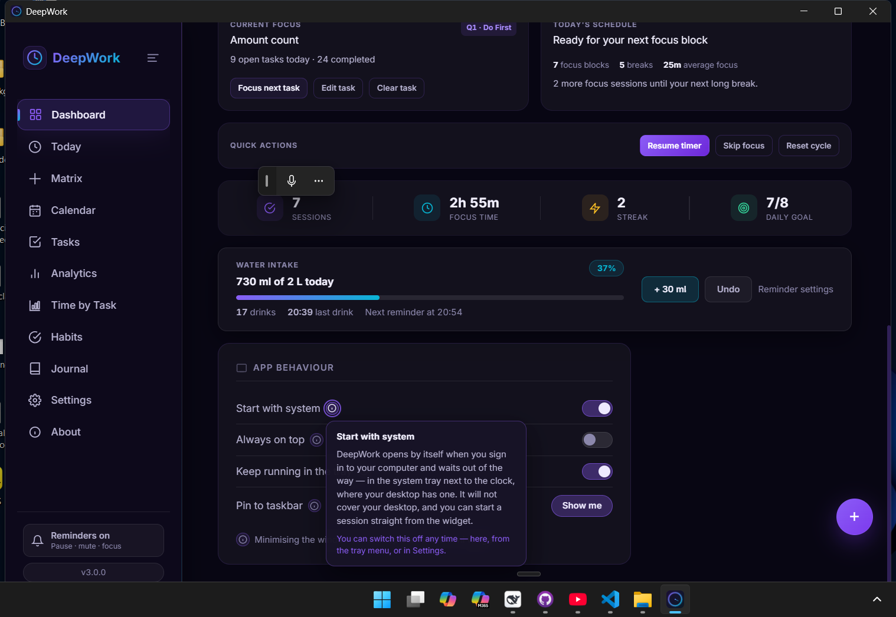
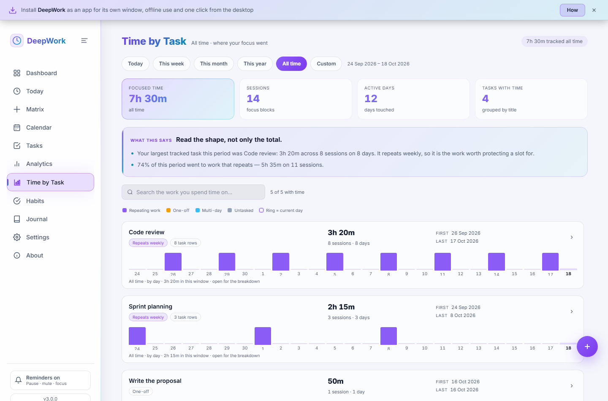
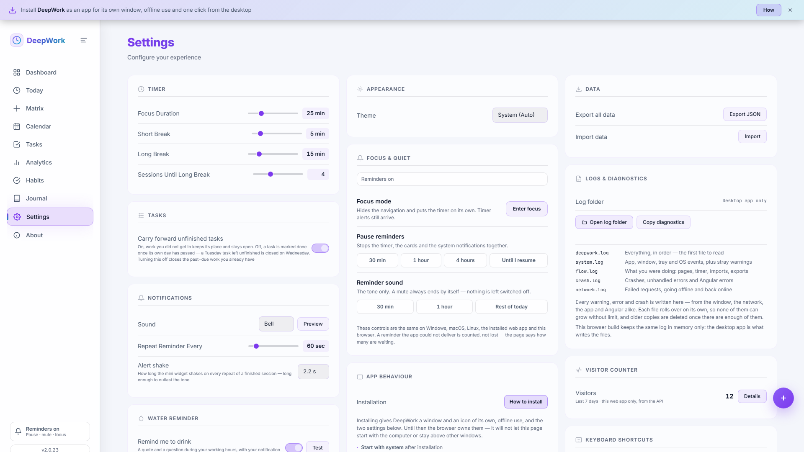

# The Pomodoro Timer That Survives You Closing the Tab

*DeepWork is a free focus timer, task manager and calendar for Windows, macOS, Linux, the browser and your phone — and it keeps every record on your own disk*

---

It is 2:47 in the afternoon and you have fourteen tabs open. One of them is a focus timer. You started a session in it an hour ago, then closed it along with the rest, because that is what you do with tabs.

Ninety seconds later you cannot remember whether you were twenty minutes in or forty. The session is gone. So is the intention behind it.

That is not a discipline problem. That is a software problem, and it is the one this article is about.

## Why every focus timer I have tried ends up closed

The pattern is always the same shape, and I have been through it enough times to recognise it early.

You find a timer. It is beautiful. It asks you to create an account, or it asks you to pick a plan, or it explains that your sessions are syncing to the cloud so you can pick up on your phone. You enter your first task. You start a block. Somewhere in the second block a notification arrives telling you to hydrate, or that a teammate has commented on something.

By Thursday you have muted it. By Friday you have stopped opening it.

The timers that survive past a week tend to share one property: they behave like software on your computer rather than like a website you are visiting. They keep running when the window is small. They remember what you were doing. They stay quiet until the timer actually ends.

That is what I wanted, so I built it. It is called DeepWork, it is free to use, and the rest of this article is what it does and why you might want it.

If you already know you want to look at it, open **[deepwork.rajatmalik.dev](https://deepwork.rajatmalik.dev)** in the next thirty seconds and come back. Nothing to install, no account, no email field. The rest will still be here. And if you want to know when the next version lands, a follow is the cheapest way to find out.

The latest version is 3.0, and it added the two things this article is really about: a page that shows you **where your focus actually went**, and reminders that **survive you closing the laptop**.

## The one decision that shaped everything

DeepWork has no account system. There is no sign in, no profile, no server of its own. Everything it knows lives in a database file on the machine you are sitting at, in the folder your operating system keeps for applications.

I want to be precise about what that buys you, because "local first" gets used loosely.

It means your focus history for the last six months cannot disappear because a company changed its pricing. It means the app opens on a plane, with the Wi-Fi off, on the version you installed. It means nobody is A/B testing a redesign of your timer. And it means the only person who can read your journal entries is you, because there is nowhere for them to go.

Three things leave the machine, and I would rather list them than let you wonder. There is a once-per-startup check to see whether a newer version exists. There is an update download, but only if you press Update. And there are the links you click, which open in your real browser. That is the whole list. The browser and phone versions add a visitor counter so the page can answer "is anyone actually using this", and there is a switch in Settings that turns it off completely.

The trade for all of this is in a later section, and it is a real one. First, though, let me show you what a day with it looks like.



*The dashboard, with an explanation attached to the setting you are looking at — the same idea runs through the whole app.*

## A day with DeepWork, from the first block to the last

I will not walk you through every screen. A dozen pages is too many to describe in a row, and reading a feature list is not how anyone decides to use something. Instead, here is the day the app is shaped around.

### Morning: work out what actually matters

You open DeepWork and land on the Dashboard. Twenty five minutes on the clock, a ring waiting to fill, a daily goal of eight sessions, and the tasks you have booked for today underneath it.

Behind that is the page I end up on most mornings. The Matrix is the Eisenhower grid, four quadrants and drag and drop between them. Do First, Schedule, Delegate, Eliminate. Dragging a card from Schedule to Do First is a fifteen second decision that saves you an hour of pretending everything is equally urgent.

The other thing that happens in the morning is the Today page. A task lands on today for one of three reasons: it is due today, it is overdue and still open, or you starred it. Starring is the override, and it is how you say "this one, today, whatever the date says".

### The block itself: a timer that rings until you answer it

You press Start, or you press Space if you are not typing in a field. The ring fills. Short break after the first three blocks, a longer one after the fourth, and you can change all of those lengths in Settings if twenty five and five are not your numbers.

When the block ends, the app does not send one polite chime and hope you noticed. It rings, shows a card, and posts a system notification, and then it repeats every interval you chose until you answer. Start, skip and stop all count as answers.

Two details here are the kind of thing you only notice after a week. Every repeat moves to the next colour of a twelve entry palette, so the alert you have been ignoring for six minutes is visibly a different colour than the one that started. And every alert carries its own line of text, drawn one per session from a list of twenty four for a finished focus block and twenty four more for the end of a break. Step away. Come back. It never shows you the same sentence twice in a row.

Ticking a task off is deliberately quieter. A card appears with a line from a third list, and no sound at all. You tick off tasks dozens of times a day; an app that rang for each one would train you to mute it, and then the session alert would be muted too.

### The middle of the day: shrink it and forget it

This is the feature I would keep above all the others. DeepWork does not disappear into your other windows. Press minimise on any page and it does not vanish into the taskbar. It shrinks into a small always on top widget, 136 by 76 pixels, with the countdown ring, the time, and play, skip, stop and expand.

It sits in the corner over your editor while you actually do the work. You can start and pause without bringing the full window back. Press Escape and it grows back to exactly where it was.

And when you press the close button, the app does not quit. It goes to the system tray and keeps running, so a session can finish and ring while the window does not exist. Tray then Exit is what actually quits, and if you prefer the close button to quit, that is a setting.

The first launch asks you about three of these things before changing anything: start with the system, stay always on top, keep running in the tray. Nothing is enabled unless you say so. No installer writes a startup entry behind your back.

### Afternoon: the calendar that schedules in pomodoros

The Calendar page is the one people underestimate. It shows you the day as events, and then does the scheduling arithmetic on top of it. It takes your quadrant order and lays your day out as focus blocks, at the block length and long break cadence your timer uses, so the day is planned in the same unit it is counted in.

A task that needs three blocks gets three. The breaks are reserved and never filled with work, which is the whole point of a break. If you drop something into a specific slot by hand, that slot is fixed and everything else flows around it.

Somewhere in the afternoon the water reminder asks you a question. It is on by default, it only fires inside the working hours you set, and it waits for an answer instead of announcing a fact. One glass counts as 30 millilitres by default, because the smallest thing anyone would call a drink is the honest unit for a day of sipping. If you minimise the window it logs the glass and leaves you alone rather than pulling the full app over your work.

The Habits page sits next to all this with current streaks, personal bests and a check-in strip per habit. Nothing clever. Just the thing that makes you not want to break the chain.

### Evening: the part that tells you what to change

Most apps hand you charts and let you draw the conclusion. Analytics in DeepWork pairs every number with a plain language reading of it.

Focus over the last seven days, with a hint telling you what the seven days before that looked like. Tasks closed, with a total underneath. Focus streak, with the number of active days behind it. Completion rate over thirty days, next to how many tasks are still open and how many are overdue. Habit consistency. Journal words over twelve weeks.

Those readings are arithmetic over your own records, computed on your machine, so the same week always produces the same reading. You can check any of them by opening the records they came from. There is no model in the loop and no guessing, which is the reason you can trust the sentence rather than just admire it.

Then the Journal. Dated entries with word counts, a weekly words chart, and one figure I did not expect to find useful: the correlation between your writing and your focus. More words on the days you worked more blocks is either a good sign or a warning, and it is more useful to know which.

## Stop Guessing Where Your Day Went

Here is the problem that made me rebuild the analysis half of the app.

I do code review most weekdays. In a task list, that is a new row every single day: *Code review* on Monday, *Code review* on Tuesday, *Code review* on Wednesday. Twenty rows a month. When I finally asked "how much of my life does code review actually take?", counting rows gave me nothing useful. It gave me twenty small numbers.

The new **Time by Task** page groups sessions by the work, not by the row. One line: **Code review — 3h 20m, 8 sessions, 8 days**, first session 26 September, last 17 October, and the word *repeats weekly* underneath it.



*Seven and a half hours, four tasks, and one sentence at the top that explains the shape of the week.*

The part I did not expect to care about is the box at the top, the one that writes the reading for you:

> Your largest tracked task this period was Code review: 3h 20m across 8 sessions on 8 days. It repeats weekly, so it is the work worth protecting a slot for.
>
> 74% of this period went to work that repeats — 5h 35m on 11 sessions.

That is not a chart. That is a sentence I can act on before lunch.

The question changes from "where did the day go?" to "which of these deserves a calendar slot?" That is a decision you can make in ten seconds, instead of a feeling you carry around all week.

## What If Your Timer Told You What Your Time Was Worth?

Worth is a dangerous word, so let me be precise about what I mean. Not money. Not points. Just this: *did the hours go to work that repeats, work that was one-off, work that spanned days, or work you never assigned at all?*

The page answers that with colour and nothing cleverer than colour. Violet for repeating work. Amber for one-off. Blue for multi-day. Slate for untasked. A ring around a bar means the current day, week, month or year. The legend above the list says all of it, so you never have to remember.

Then I opened my own numbers and got embarrassed.

*Write the proposal* — the thing I would have called my real work that month — was **50 minutes**. One session. One day. Code review, the thing I think of as the chore between real work, was **3h 20m**. Four times as much.

I am not telling you the answer was wrong. I am telling you I had never seen the question. Maybe code review is load-bearing and deserves the slot it already takes. Maybe the proposal deserved more. Both are decisions. Guessing is not a decision — it is just a habit with better branding.

The window is not fixed, either. **Today**, **This week**, **This month**, **This year**, **All time**, and **Custom** with two date fields — pick the same day twice to read a single strange day, or two dates to read any span. Open a row and you get the breakdown table, the averages, and the individual sessions behind the total.

And when time is recorded with no task attached, it does not vanish into a rounding error. It appears as **Untasked focus**, with the one sentence that fixes it next time. The page is honest about its own blind spot, which is rarer than it should be.

The list also stays fast however long your history gets, because only the rows in view are drawn. A year of sessions scrolls like a week of them.

## The reminder that outlives your laptop

Now the story that changed how I think about the whole app.

A presentation at 9:00. I set a reminder the night before, closed the laptop at 8:40, and walked into a room with no laptop in it. Every timer-based reminder I have ever used dies exactly there, because a timer needs something to be running.

A stored record does not. When I opened the laptop again, the card was still waiting, and it said the thing I did not know I needed to read:

> It was due at 09:00. We kept it for you.

That is the new **Reminders** page — built for the moments when you are standing in front of a room and cannot answer. It escalates instead of repeating on a stopwatch: three minutes, five, ten, fifteen, twenty, then every thirty minutes if you have set it to *Insistent*. It measures from the last real ring, so a snooze cannot quietly shorten the gap.

There is no close cross on the card and no timeout. Only three exits: **Done**, **Snooze 10 min**, **Stop reminding** — the same three answers the desktop notification carries. And it never brings the window forward, because the moments it exists for are exactly the moments when stealing your focus would be the opposite of help.

You stop being the memory. Not the remembering of the thing — the holding of it, all day, in the back of your head.

## The quiet parts are the feature

Everything above is one idea wearing different clothes: remove the noise so the thing in front of you is the only thing in front of you. A few of the decisions that follow from it are worth naming, because they are the ones you feel rather than see.

**Pause and mute are everywhere.** The same small panel opens from the sidebar, the phone's top bar, Settings and `Ctrl+Shift+Q` — on Windows, macOS, Linux, the installed web app and a plain browser tab alike. A pause holds the timer *and* every reminder. A mute is sound only, and always ends by itself, so you cannot leave yourself deaf for a week by accident.

**Focus mode leaves the clock and nothing else.** `Ctrl+Shift+F` hides the navigation and the panels; the timer keeps running and the alerts still arrive. `Esc` brings the room back exactly as you left it.

**Nothing is trying to sell you anything.** No upgrade banner, no streak guilt, no "you have not opened the app in three days" email — because there is no email field and no server to send it from. The only thing that ever interrupts you is something you asked to be interrupted by.

**The app is quiet by default in the places that matter.** Ticking a task off makes no sound. A reminder never raises the window. A finished block rings, and rings, and then stops when you answer it. That is the entire interruption budget.

## Where you can use it

The whole app runs at **[deepwork.rajatmalik.dev](https://deepwork.rajatmalik.dev)**. Three ways in, depending on where you are sitting:

**In a browser tab.** Open the site and start. No account, no sign-in, no email field, nothing to configure first. This is the fastest way to find out whether the shape of the app matches the shape of your day.

**On your phone.** Open the same address in your phone's browser and choose **Add to Home Screen** from the share or menu button. It opens full screen without browser chrome, keeps its own icon, and works offline once it has loaded — so the timer and your tasks are there on a train or in a room with no signal. The same pause, mute and focus panel opens from the phone's top bar, so the controls you use at your desk are the controls you get in your hand.

**As a desktop app.** While you are in the app, open **About → Get it on another device** and it offers the build for the machine you are on — Windows, macOS or Linux. The desktop version is the one with the tray, the always-on-top mini widget and start-with-system, and it keeps its database in a single file on your own disk. Nothing to log into, nothing to cancel, and nothing that can take your history away when a pricing page changes.

Your records stay with you in all three. The browser and phone versions keep them in that browser's own storage, so export a backup from **Settings** before clearing site data. The desktop version keeps the real database on your machine, and the same **Settings → Export** writes a single dated JSON file you can restore anywhere.

## The details you find by poking around

Feature lists are boring. These are the things that made me keep a copy installed.

**Excel import that shows you what it will do before it does it.** Tasks, then Import, accepts `.xlsx`, `.xlsm` and `.csv`, recognises the headers people actually write (`Task`, `Due Date`, `Prio`, `Labels`), validates every row, and writes nothing until you confirm the preview. Duplicate titles are labelled, and you choose whether to skip them. There is a download template with real dropdowns and an instructions sheet, if you want your spreadsheet to be valid before you start.

**Export that tells you where the file went.** Twenty four columns per task, quick ranges like Today and Last 7 days, an optional totals block, and UTF-8 with a BOM so accents and non Latin scripts survive Excel. It writes into your Downloads folder, shows you the full path, and never overwrites: the second export of the day becomes `export-2026-09-13 (2).csv`.

**More than twenty keyboard shortcuts.** `Ctrl+1` through `Ctrl+0` jump between pages. `Ctrl+Shift+F` is focus mode, which is the clock and nothing else. `Space` starts and pauses. With a task card focused, `1`, `2` and `3` move it between To Do, In Progress and Done, the arrow keys walk it along the board, and `Enter` opens it for editing.

**Editing from wherever you are reading.** Every card that shows a task carries the way into the same task form: a pencil on a board card, a pencil on a Matrix quadrant, one on a Calendar rail card, and Edit at the top of the Matrix right click menu. You never have to go and find the page that owns the task.

**A backup you can actually restore.** Settings writes a single dated JSON file with your sessions, tasks, habits, journal and water records. Importing it overwrites what you have, after a confirmation, because it is a restore and not a merge.

**Diagnostics for when something breaks.** Settings then Logs and Diagnostics shows you the app's own logs, opens the folder, and has a Copy diagnostics button that puts the last three hundred lines plus your environment on the clipboard. If you ever report a bug, that is the thing to paste.

**Settings that explain themselves.** Every toggle carries a short sentence saying what it does and what happens if you turn it off. It is a small thing until the first time you cannot remember what "keep running in the tray" actually means at 11pm.



*One screen holds the whole administrative surface of the app: timer lengths, focus and quiet, backup, and a log folder you can open.*

**Themes, fonts and no network.** System, light and dark themes, two bundled typefaces, and no font CDN, so it looks like itself offline or behind a company proxy.

## What it is not, and the trade you are making

I would rather you decide with the whole picture.

**It does not sync.** Each machine has its own database. Moving your work between two computers means exporting the backup on one and importing it on the other. There is no server, and nothing arrives on your other device by itself.

**It is one person's app.** One developer, built in public, with a changelog that is longer than this article. There is no support team and no roadmap meeting.

**There is no AI.** Every reading on Analytics and Time by Task is arithmetic over your own records. Same records, same reading, every time — and you can check it.

**The installers are not code signed.** This is the one that makes people nervous, so here is exactly what happens. On Windows you will see "Windows protected your PC" from SmartScreen, and the UAC dialog will say Unknown publisher. On macOS, Gatekeeper will refuse the first launch with a message about not being able to verify the app. Both are the absence of a signature worth several hundred dollars a year, not a sign of a broken download.

**The browser and phone versions are the most disposable of the three.** Anything you do there lives in that browser's storage, and clearing site data erases it. If you want the real database, install the desktop app.

**It is not a team tool.** No sharing, no assignment, no comments, no collaboration. One person, one set of records, by design.

If any of those are deal breakers, that is a fair answer, and the web app is still there for you to try before deciding.

## How to start in the next five minutes

**The fastest route is the browser.** Open **[deepwork.rajatmalik.dev](https://deepwork.rajatmalik.dev)**, and if you like it, install it as an app from your browser's menu. In Chrome or Edge that is the install icon in the address bar. In Safari 17 or newer it is File, then Add to Dock. Firefox cannot install web apps, so use the desktop build there.

**On a phone**, the same address plus Add to Home Screen gives you the full screen version, offline once loaded.

**The real thing is the desktop build.** **About → Get it on another device** resolves the download for your machine — Windows 10 and newer (64 bit or 32 bit, `.exe` or `.msi`), macOS (`.dmg`, separate Intel and Apple Silicon builds), and Linux (`.AppImage`, `.deb` or `.rpm`).

Because nothing is signed, here is what gets you past it.

```bash
# Linux: make the AppImage runnable
chmod +x DeepWork_*.AppImage

# macOS 15 and later: clear the quarantine flag after the first refusal
xattr -dr com.apple.quarantine /Applications/DeepWork.app
```

On Windows, choose More info, then Run anyway, only if you trust the source. On macOS, the old Control click trick no longer works on recent versions; open System Settings, Privacy and Security, Security, and use Open Anyway after the first attempt.

Then let the first launch ask you its three questions, answer them honestly, and start a block.

## A ten minute tour, if you want the short version

If you install it and then wonder where to begin, do these in order. It is the fastest way to find out whether it fits how you work.

1. Press `Ctrl+2` and add three tasks, starring the one you would do first if the day went well.
2. Press `Ctrl+3` and drag those three into quadrants honestly, not optimistically.
3. Press `Ctrl+4` and look at what your day becomes when it is laid out as blocks.
4. Go back to the Dashboard, press `Space`, and then press minimise. Watch what happens.
5. Let the block finish and ignore the alert for two minutes. Notice the colour has changed.
6. Press `Ctrl+7` and see your work grouped by what the focus actually paid for.
7. Press `Ctrl+6` and read the hint under each number.
8. Open Settings and change one thing you dislike.

Eight steps, ten minutes, and by the end you will know whether the shape of this app matches the shape of your day. If it does not, uninstall it; there is no account to delete and nothing to cancel.

## If something is missing, say so

This is the part where a one person app genuinely needs you.

This is the third major version, and a good number of the fixes in it came from using the app daily and writing down what annoyed me. The ones that did not came from people telling me.

So if you try it and something is wrong, the most useful things to send are concrete. What you did, what you expected, what happened instead, and which page you were on. If it is a crash or something looks broken, use Settings, Logs and Diagnostics, Copy diagnostics, and paste that in. It saves an hour of guessing.

Feature requests are welcome too, and the honest answer is sometimes no. If it is a no, you will get a why.

The place to put it is **[contact@rajatmalik.dev](mailto:contact@rajatmalik.dev)**. If you would rather just say it worked, that is also useful. Knowing which features people actually use is how the next version gets decided.

Have you ever abandoned a focus app because it asked for an account on day one? I would like to know what pushed you off, because that list is the one I am trying to avoid.

## Back to that tab

It is 2:47 in the afternoon and you have fourteen tabs open. One of them is DeepWork, because you installed it, and closing the tab does not matter any more.

The window is small, in the corner, over your editor. The ring is two thirds full. Your three tasks for today are on the board, one of them is in progress, and the fourth block is scheduled for after the break. The app is not asking you for anything.

When the block ends, it will ring, and it will keep ringing, and it will not stop until you decide you are done with it. That is the whole promise. The timer is the only thing that has to stop.

## If you try it

**Tell me how it went.** Did the ten minute tour match how you actually work, or did the app get in your way? Leave a comment and I read everything.

**Found this useful?** If it saved you from another timer that forgets you the moment you close the tab, hit the clap button so more people find it. It genuinely helps a one person project more than it does a big one.

**Want the next one?** I write about the tools I build and the decisions behind them, roughly once a week. Follow me here on Medium, where I am [@codewithrajat](https://medium.com/@codewithrajat), or subscribe to the newsletter so you do not miss the next version.

Let us connect. Find me on [LinkedIn](https://www.linkedin.com/in/errajatmalik/) and tell me what your day actually looks like. And if you know someone whose focus timer lives in a tab they keep closing, send them this article.

